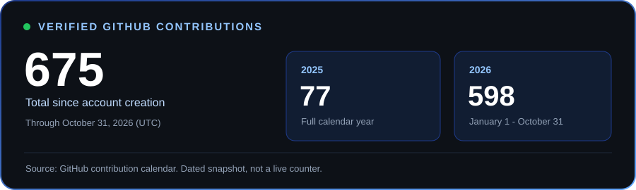

  

  

<h3 align="center">Software Engineering Student · Backend &amp; Full-Stack Development</h3>

  

  
  
  
  

  <a href="https://mr-dev.me"><b>Portfolio</b></a> ·
  <a href="https://github.com/ivan-14-dev?tab=repositories"><b>Projects</b></a> ·
  <a href="mailto:ivanbayigabogmis0@gmail.com"><b>Email</b></a>

---

<h2 align="center">👨‍💻 About Me</h2>

Based in Cameroon, I build web and mobile applications for practical needs in healthcare, education, and inventory management. My main focus is backend development with **Java / Spring Boot** and **Python / Django**, connected to web and mobile interfaces.

<table>
  <tr>
    <td width="50%" valign="top">
      <h3>⚙️ What I Build</h3>
      <ul>
        <li>Backend services and REST APIs</li>
        <li>Full-stack web applications</li>
        <li>Mobile and desktop applications</li>
        <li>Data-driven management tools</li>
      </ul>
    </td>
    <td width="50%" valign="top">
      <h3>🌱 What I Explore</h3>
      <ul>
        <li>Modular application architecture</li>
        <li>Authentication and authorization</li>
        <li>Cloud deployment and CI/CD</li>
        <li>Distributed systems</li>
      </ul>
    </td>
  </tr>
</table>

---

<h2 align="center">🛠️ Technologies &amp; Tools</h2>

  

The technologies behind the projects below:

| Area | Technologies |
| --- | --- |
| Backend | Java, Spring Boot, Python, Django, Django REST Framework |
| Web | JavaScript, React |
| Mobile & desktop | Dart, Flutter, JavaFX |
| Data & storage | PostgreSQL, Firebase, Hive |

---

<h2 align="center">🚀 Featured Projects</h2>

<table>
  <tr>
    <td width="50%" valign="top">
      <h3>🏥 <a href="https://github.com/ivan-14-dev/GinDHO">GinDHO</a></h3>
      
<b>Medical Assistance System</b>

      
Patient records, appointment scheduling, and role-based access for patients, doctors, and administrators across web and desktop interfaces.

      
<b>Stack:</b> Java · Spring Boot · PostgreSQL · React · JavaFX

      
<a href="https://github.com/ivan-14-dev/GinDHO">Source, setup &amp; API documentation →</a>

    </td>
    <td width="50%" valign="top">
      <h3>📚 <a href="https://github.com/ivan-14-dev/library-Manager">Library Manager</a></h3>
      
<b>Academic Library Management</b>

      
A web application for library catalogs, loans and returns, user roles, and academic publications.

      
<b>Stack:</b> Python · Django · Django REST Framework · React

      
<a href="https://github.com/ivan-14-dev/library-Manager">Source, workflows &amp; setup →</a>

    </td>
  </tr>
  <tr>
    <td width="50%" valign="top">
      <h3>📦 <a href="https://github.com/ivan-14-dev/ManStock-Mobile">ManStock Mobile</a></h3>
      
<b>Inventory Management</b>

      
A Flutter inventory application with stock movement tracking, Firebase synchronization, and local storage for offline use.

      
<b>Stack:</b> Dart · Flutter · Firebase · Hive

      
<a href="https://github.com/ivan-14-dev/ManStock-Mobile">Source, synchronization approach &amp; setup →</a>

    </td>
    <td width="50%" valign="top">
      <h3>🚗 <a href="https://github.com/ivan-14-dev/RoadGuardian-releases">RoadGuardian</a></h3>
      
<b>Road Safety · Android Releases</b>

      
A road-safety mobile project with a public repository for signed Android APKs. <b>Application source code is not included.</b>

      
<b>Status:</b> Evaluation release candidate, not a validated stable release.

      
<a href="https://github.com/ivan-14-dev/RoadGuardian-releases/releases">Release notes &amp; downloads →</a> · <a href="https://github.com/ivan-14-dev/RoadGuardian-releases#verification">Checksum verification</a>

    </td>
  </tr>
</table>

<b>🔎 GinDHO — architecture and screen-flow diagrams</b>

Design documentation from the GinDHO repository, not application screenshots.

**System architecture**

**Screens by user role**

---

<h2 align="center">📊 GitHub Activity</h2>

  

**675 contributions recorded by GitHub from account creation through October 31, 2026 (UTC).**

| Period | Contributions |
| --- | ---: |
| [2025](https://github.com/ivan-14-dev?tab=overview&from=2025-01-01&to=2025-12-31) | 77 |
| [January 1 - October 31, 2026](https://github.com/ivan-14-dev?tab=overview&from=2026-01-01&to=2026-10-31) | 598 |

Source: GitHub's official contribution calendar. Contributions include more than commits; this is a dated snapshot, not a live counter. The profile's rolling-year total covers a different period.

  <a href="https://github.com/ivan-14-dev?tab=overview"><b>View my live contribution graph →</b></a>

  <picture>
    <source media="(prefers-color-scheme: dark)" srcset="https://raw.githubusercontent.com/ivan-14-dev/Ivan-14-dev/output/github-contribution-grid-snake-dark.svg" />
    <source media="(prefers-color-scheme: light)" srcset="https://raw.githubusercontent.com/ivan-14-dev/Ivan-14-dev/output/github-contribution-grid-snake.svg" />
    
  </picture>

Contribution animation generated daily by GitHub Actions.

---

<h2 align="center">🤝 Let's Connect</h2>

  <b>Have an idea, a project, or a technical challenge?</b> 
  Let's build something useful together.

  
  
  
  

  <a href="mailto:ivanbayigabogmis0@gmail.com">ivanbayigabogmis0@gmail.com</a>

---

  
   
  <b>Software Engineering with purpose.</b> 
  🇨🇲 <i>Building from Cameroon, creating for the world.</i>

  

